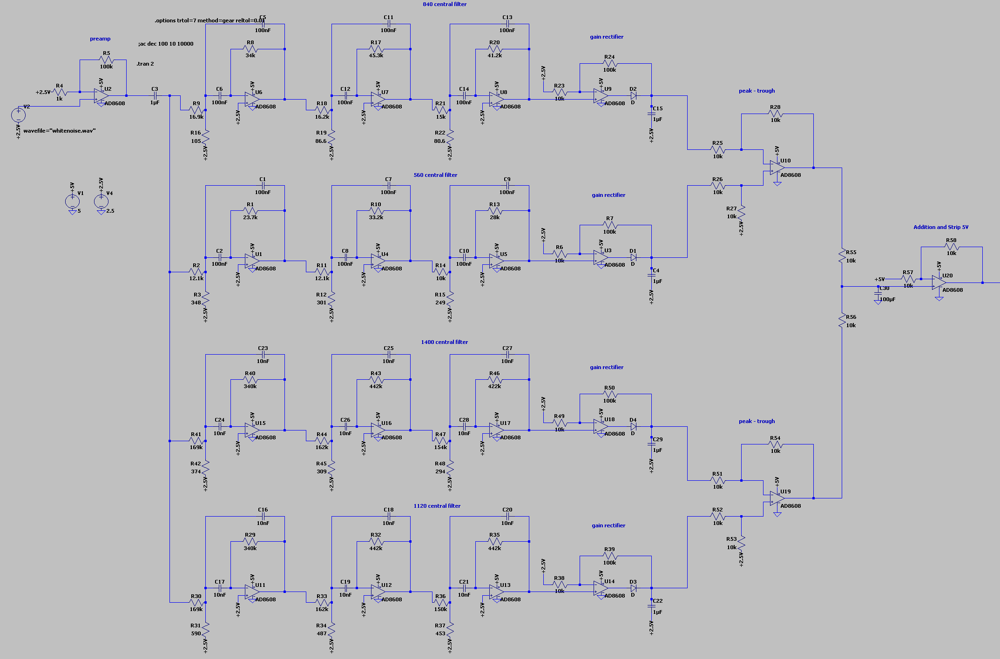

# Active Analog Audio Filter & Mosquito Detector

Multi-stage analog acoustic signal-processing and detection circuit targeting the female Asian Tiger Mosquito (Aedes albopictus) wingbeat harmonic frequency, designed in **LTspice** and validated on the bench against background noise.

## System Architecture
- **Input & Preamp:** MAX4466 microphone preamplifier stage
- **Bandpass Filtering:** Four parallel 6th-order Multiple Feedback (MFB) active bandpass channels (cascaded 2nd-order stages) implemented with **MCP6284-E/P** quad op-amps, balancing steep roll-off, quality factor ($Q$), and component budget constraints
- **Envelope / Detection & Display:** Precision rectification, op-amp subtraction/comparison stages, and an **LM3914** LED bar driver

## Simulation & Bench Validation
- Modeled filter stages and full signal chain in **LTspice** to verify passband gain, stopband attenuation, and stage stability.
- Built and tested physically on the bench, comparing measured voltages and waveforms against LTspice predictions using recorded mosquito wingbeat audio versus ambient background noise.

## Repository Contents
- `ltspice/` — LTspice schematics and simulation files
- `images/` — Schematics, frequency-response plots, and simulation vs. bench validation captures

Mosquito audio taken from the USDA Bug Bytes : [catalog.data.gov/dataset/bug-bytes-sound-library-stored-product-insect-pest-sounds](catalog.data.gov/dataset/bug-bytes-sound-library-stored-product-insect-pest-sounds)
